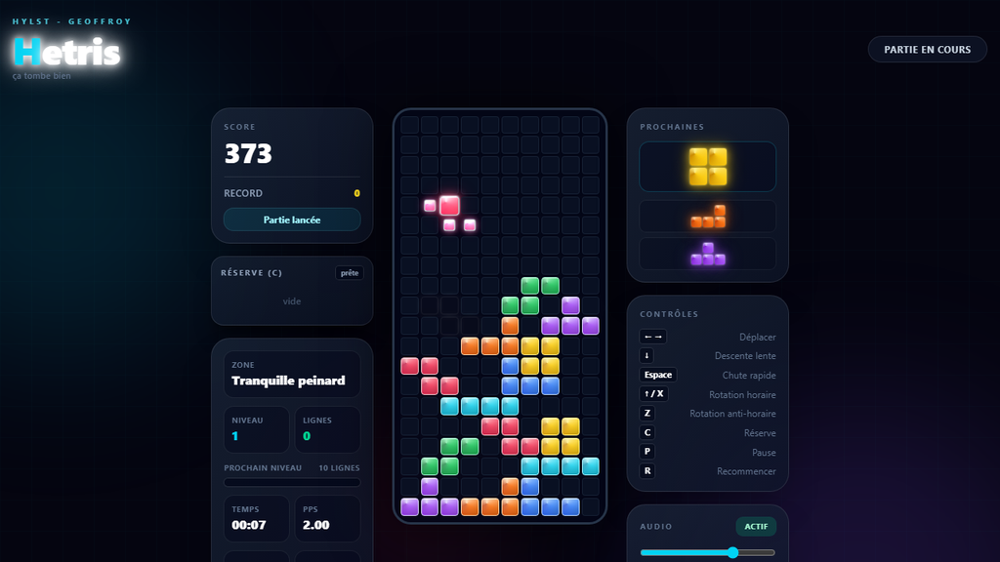

# Hetris

**ça tombe bien.**

Le puzzle de blocs qui tombent, version Hylst. Tu empiles, tu alignes, tu encaisses.

Joue ici : [games.hylst.fr/hetris/](https://games.hylst.fr/hetris/)



## Comment on joue

Des pièces de quatre cases descendent une par une. Tu les fais glisser et pivoter pour
compléter des rangées horizontales : chaque rangée pleine disparaît et te rapporte des
points. La partie s'arrête quand une nouvelle pièce n'a plus la place d'apparaître.

Plus tu effaces de lignes d'un coup, plus ça paie :

| Lignes | Points (× niveau) |
|--------|-------------------|
| 1 | 100 |
| 2 | 300 |
| 3 | 500 |
| 4 (quadruple) | 800 + 400 de bonus |

Les enchaînements comptent aussi : chaque effacement consécutif ajoute un bonus de combo, et
si tu arrives à vider complètement le plateau c'est 1500 × niveau. Bon courage.

Un niveau tous les 10 lignes. Ça accélère, et la musique se tend avec toi.

## Contrôles

| Touche | Action |
|--------|--------|
| ← → | Déplacer |
| ↓ | Descente lente (+1 point par case) |
| Espace | Chute rapide (+2 points par case) |
| ↑ ou X | Rotation horaire |
| Z | Rotation anti-horaire |
| C | Mettre la pièce en réserve, ou l'échanger |
| P | Pause |
| R | Recommencer |
| Entrée | Lancer la partie depuis le menu |

Sur mobile, six boutons sous le plateau font la même chose.

## Difficultés

| Mode | Vitesse | Cadeau de bienvenue |
|------|---------|---------------------|
| Facile | ×0.8 | rien |
| Normal | ×1 | rien |
| Difficile | ×1.3 | 2 rangées de gravats |
| Expert | ×1.8 | 4 rangées de gravats |
| Cauchemar | ×2.5 | 6 rangées de gravats |

## Ce qu'il y a dedans

- Pièce fantôme, pour voir où le truc va atterrir
- Réserve (hold), une fois par pièce
- Les 4 prochaines pièces affichées, tirage par sac de 7 mélangé
- Lock delay : un court instant pour rectifier une pièce posée au sol
- Déplacement latéral continu si tu gardes la flèche appuyée
- Musique et ambiance générées à la volée en Web Audio, qui évoluent avec le niveau
- Alerte visuelle et sonore quand la pile devient inquiétante
- Record perso gardé en local
- Plein écran, volume, coupure du son

## L'arborescence

```
hetris-game-development/
├── index.html          # template + bloc SEO
├── vite.config.ts      # base '/hetris/' + singlefile
├── public/
│   ├── favicon.png
│   ├── og-image.png
│   └── og-image.webp
└── src/
    ├── main.tsx        # point d'entrée React
    ├── App.tsx         # tout l'UI, le HUD, la boucle, les entrées
    ├── engine.ts       # la logique pure : pièces, rotations, collisions, score
    ├── audio.ts        # synthèse Web Audio (SFX + musique)
    ├── index.css       # Tailwind + keyframes
    └── utils/cn.ts     # helper de classes
```

## Dev

```bash
npm install
npm run dev       # http://localhost:5173/hetris/
npm run build     # dist/index.html, un seul fichier
npm run preview
```

## Stack

React 19, TypeScript 5.9 (strict), Tailwind CSS 4, Vite 7, vite-plugin-singlefile.

Zéro dépendance à l'exécution, zéro backend, zéro asset externe : le jeu tient dans un seul
fichier HTML et tourne hors ligne. Les graphismes sont du CSS (pas une seule image dans le
jeu), les sons sont synthétisés au vol.

## Licence

MIT, Geoffroy Streit (Hylst)
